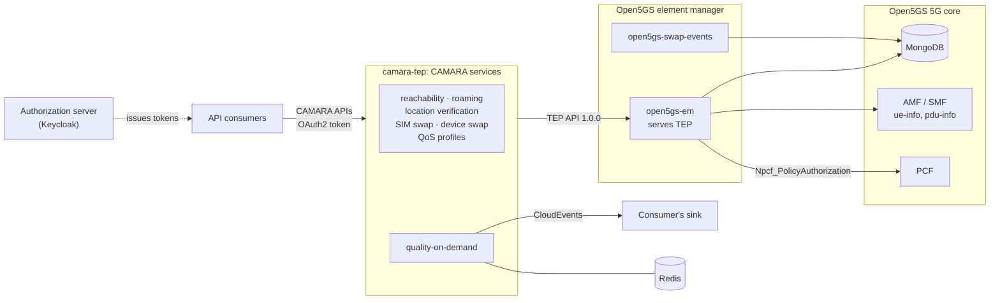

# TEP architecture

**TEP (Telco Exposure & Programmability)** exposes a 5G core to applications through
standard [CAMARA](https://camaraproject.org/) APIs, without tying those APIs to any one core.

It does this with one contract in the middle, the **TEP API**:

- **Above it**, the CAMARA services translate CAMARA requests into TEP calls. They know nothing
  about the core.
- **Below it**, each 5G core has an **element manager** that serves the TEP API from that
  core's own data and network functions. Open5GS is the reference implementation.

Swapping the core means deploying another element manager behind the same contract. The
CAMARA services don't change.

## The picture

The [TEP contract](https://github.com/pnet-software/tep-openapi) is an OpenAPI spec. The
element manager's server and the CAMARA services' TEP client are both generated from it, so
the two sides can't drift apart.

## Repositories

| Repository | Layer | What it holds |
|---|---|---|
| [tep-openapi](https://github.com/pnet-software/tep-openapi) | Contract | The TEP API spec and the 3GPP AsSessionWithQoS bundle it references |
| [tep-architecture](https://github.com/pnet-software/tep-architecture) | | These docs |
| [camara-tep](https://github.com/pnet-software/camara-tep) | Northbound | The CAMARA services, their shared libraries, a chart per service and an umbrella chart |
| [open5gs-em](https://github.com/pnet-software/open5gs-em) | Southbound | open5gs-em: the TEP API on Open5GS |
| [open5gs-swap-events](https://github.com/pnet-software/open5gs-swap-events) | Southbound | Records SIM and device swaps from Open5GS's subscribers |
| [open5gs-em-stack](https://github.com/pnet-software/open5gs-em-stack) | Deployment | One chart for the Open5GS core, open5gs-em and open5gs-swap-events |

## CAMARA APIs

| CAMARA API | Version | Service | What it asks TEP |
|---|---|---|---|
| Device Reachability Status | v1.1.0 | `reachability` | `POST /subscriber/status` |
| Device Roaming Status | v1.1.0 | `roaming` | `POST /subscriber/status` (its `roaming`) |
| Device Location Verification | v3.0.0 | `locationverification` | `POST /subscriber/location`, then `/subscriber/status` to tell unknown from unlocatable |
| SIM Swap | v2.1.0 | `simswap` | `POST /subscriber/swaps` (its `latestSimChange`) |
| Device Swap | v1.1.0 | `deviceswap` | `POST /subscriber/swaps` (its `latestDeviceChange`) |
| QoS Profiles | v1.1.0 | `qosprofiles` | `GET /quality-profile`, `GET /quality-profile/{name}` |
| Quality-On-Demand | v1.1.0 | `qualityondemand` | Quality profiles, subscriber status, and 3GPP AS sessions with QoS |

All seven run on Open5GS through open5gs-em.

## Read more

| Document | About |
|---|---|
| [TEP contract](docs/tep-contract.md) | What the TEP API offers, its conventions, and how the spec is kept and versioned |
| [CAMARA services](docs/camara-services.md) | How a CAMARA request becomes TEP calls: security, Quality-On-Demand, correlation and logging |
| [Element managers](docs/element-managers.md) | What a core must provide to serve TEP, the Open5GS implementation, and adding another core |
| [Deployment](docs/deployment.md) | Charts, images, releases, and the trust boundaries in a cluster |
| [Design decisions](docs/decisions.md) | The choices behind this architecture |
