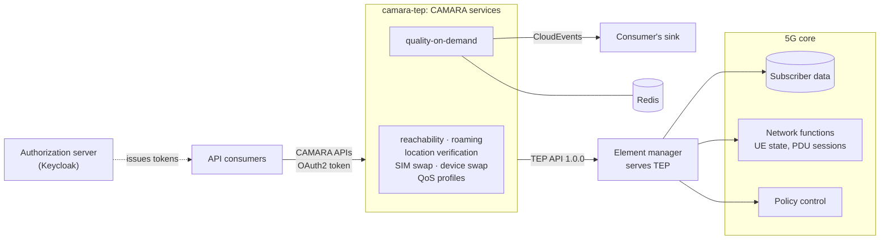

# TEP architecture

**TEP (Telco Exposure & Programmability)** exposes a 5G core to applications through
standard [CAMARA](https://camaraproject.org/) APIs, without tying those APIs to any one core.

It does this with one contract in the middle, the **TEP API**:

- **Above it**, the CAMARA services translate CAMARA requests into TEP calls. They know nothing
  about the core.
- **Below it**, each 5G core has an **element manager** that serves the TEP API from that
  core's own data and network functions.

Swapping the core means deploying another element manager behind the same contract. The
CAMARA services don't change.

## The picture

The [TEP contract](https://github.com/pnet-software/tep-openapi) is an OpenAPI spec. Every
element manager's server and the CAMARA services' TEP client are generated from it, so the
two sides can't drift apart.

## Repositories

| Repository | Layer | What it holds |
|---|---|---|
| [tep-openapi](https://github.com/pnet-software/tep-openapi) | Contract | The TEP API spec and the 3GPP AsSessionWithQoS bundle it references |
| [tep-architecture](https://github.com/pnet-software/tep-architecture) | | These docs |
| [camara-tep](https://github.com/pnet-software/camara-tep) | Northbound | The CAMARA services, their shared libraries, a chart per service and an umbrella chart |

Each implemented core adds its own southbound repositories (element manager, helpers and
deployment chart). They're listed on the core's page.

## CAMARA APIs

| CAMARA API | Version | Service | What it asks TEP |
|---|---|---|---|
| Device Reachability Status | v1.1.0 | `reachability` | `POST /subscriber/status` |
| Device Roaming Status | v1.1.0 | `roaming` | `POST /subscriber/status` (its `roaming`) |
| Device Location Verification | v3.0.0 | `locationverification` | `POST /subscriber/location`, then `/subscriber/status` to tell unknown from unlocatable |
| SIM Swap | v2.1.0 | `simswap` | `POST /subscriber/swaps` (its `latestSimChange`) |
| Device Swap | v1.1.0 | `deviceswap` | `POST /subscriber/swaps` (its `latestDeviceChange`) |
| QoS Profiles | v1.1.0 | `qosprofiles` | `GET /quality-profile`, `GET /quality-profile/{name}` |
| Quality-On-Demand | v1.1.0 | `qualityondemand` | Quality profiles, subscriber status, and 3GPP AS sessions with QoS |

## Implemented cores

| Core | Element manager | CAMARA APIs | Details |
|---|---|---|---|
| Open5GS | [open5gs-em](https://github.com/pnet-software/open5gs-em) | All seven | [Open5GS implementation](docs/open5gs.md) |

To add a core, see [Adding another core](docs/element-managers.md#adding-another-core).

## Read more

| Document | About |
|---|---|
| [TEP contract](docs/tep-contract.md) | What the TEP API offers, its conventions, and how the spec is kept and versioned |
| [CAMARA services](docs/camara-services.md) | How a CAMARA request becomes TEP calls: security, Quality-On-Demand, correlation and logging |
| [Element managers](docs/element-managers.md) | What a core must provide to serve TEP, and adding another core |
| [Deployment](docs/deployment.md) | Charts, images, releases, and the trust boundaries in a cluster |
| [Design decisions](docs/decisions.md) | The choices behind this architecture |

## Deploying

| Guide | For |
|---|---|
| [Deploying the demo](docs/deploy-demo.md) | Trying TEP end to end on an empty cluster: Open5GS, its UPF, TEP and the CAMARA APIs in one release |
| [Adding TEP to an existing Open5GS](docs/deploy-existing-open5gs.md) | An Open5GS (2.8.0 or later) you already run: TEP, the swap recorder and the CAMARA APIs next to it |

These docs are also published as a site: <https://pnet-software.github.io/tep-architecture/>.

## License

Copyright 2026 P-NET New Generation Emerging Networks & Verticals Private Company.

Licensed under the [Apache License, Version 2.0](LICENSE). You may use, modify and redistribute this work, provided you keep the copyright and license notices and include the [NOTICE](NOTICE) file in what you distribute.
