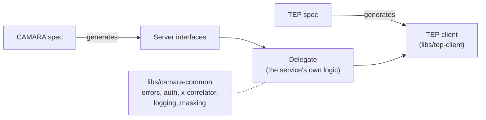
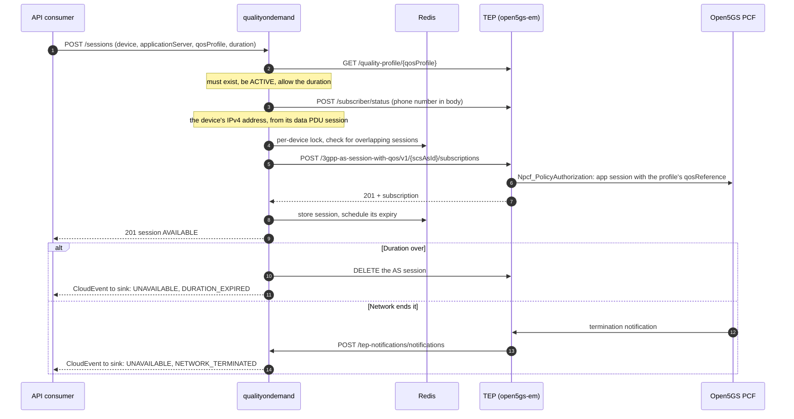

# CAMARA services

[camara-tep](https://github.com/pnet-software/camara-tep) is one repository with one Spring
Boot service per CAMARA API. Each service turns a CAMARA request into TEP calls and maps the
answer back. It has no code for any particular core.

## Shape of a service

- **Generated server.** Each service's API layer is generated from the CAMARA spec, so
  paths, models and validation follow the spec.
- **Delegate.** The only code specific to one API: it resolves the device, calls TEP, and
  maps TEP's answer to the CAMARA response and errors.
- **Shared libraries.** They are built in the same Maven reactor as the services and are
  never published separately:
  - `tep-client`: generated from the TEP spec, with its RestClient wiring and `TEP_*`
    configuration.
  - `camara-common`: CAMARA Commonalities, which covers `ErrorInfo` errors, the
    `x-correlator` filter, token handling, the access log and log masking.

## Security

Each service is an OAuth2 **resource server**, enforcing the `openId` security its CAMARA
spec declares. It only checks tokens; an authorization server issues them. That can be
Keycloak, deployed with the camara chart, or the operator's own.

1. **Token.** Signature, expiry and issuer are checked against the issuer's discovery
   document and keys. A missing or bad token is 401 `UNAUTHENTICATED`.
2. **Scope.** The token must carry the API's scope (e.g. `device-reachability-status:read`),
   or it is 403 `PERMISSION_DENIED`.
3. **Who the request is about:**
   - **Two-legged** token (client credentials): the device's phone number must be in the
     body.
   - **Three-legged** token (a subscriber logged in and consented): the phone number comes
     from the token's phone number claim, and a device in the body is rejected.

Calls from the services to TEP are not authenticated; they stay inside the cluster. See
[Deployment](deployment.md#trust-boundaries).

## The simple APIs

Six of the seven APIs are one or two TEP reads each:

| API | TEP call | Answer |
|---|---|---|
| Reachability | `POST /subscriber/status` | Not reachable when deregistered; `DATA` for a PDU session to a DNN other than `ims`; `SMS` for an `ims` session |
| Roaming | `POST /subscriber/status` | TEP's `roaming`. The element manager compares the serving PLMN with its configured home PLMNs. When roaming, the country comes from the serving MCC. |
| Location verification | `POST /subscriber/location` | The cell's coverage circle against the requested circle: `TRUE`, `FALSE`, or `PARTIAL` with a match rate. `lastLocationTime` is when the UE last reported its cell. |
| SIM swap | `POST /subscriber/swaps` | `latestSimChange`, the last IMSI change for the phone number |
| Device swap | `POST /subscriber/swaps` | `latestDeviceChange`, the last IMEISV change for the phone number |
| QoS profiles | `GET /quality-profile[/{name}]` | TEP's quality profiles, field for field |

## Quality-On-Demand

Quality-On-Demand is the one stateful service. A CAMARA QoD session is a 3GPP AS session with
QoS in TEP. Sessions live in **Redis**, which every replica shares.

- **Conflicts.** A new session conflicts with an `AVAILABLE` session of the same device whose
  flows overlap. That is 409, and so is a second create for the device while one is in
  progress.
- **Expiry.** Every replica checks for expired sessions, and each one is claimed by exactly
  one replica.
- **Notifications from TEP** arrive at `/tep-notifications/notifications`. That path takes no
  token and lies outside `/quality-on-demand`, so the ingress never exposes it.
- **Visibility.** A session is visible only to the API client that created it and, with a
  three-legged token, to its subscriber.

## Correlation and logging

- **One correlator per request.** Each request uses its `x-correlator`, or a generated
  UUID if it has none. The value is on every log line of the request and is forwarded to
  TEP and to QoD sinks, so one value finds a request across the API, TEP and the
  notification.
- **One log line per API request and one per TEP call**, in ECS JSON by default.
- **Never logged:** bodies, query strings, tokens, or sink URLs (only their host). Phone
  numbers that do appear are masked, e.g. `+3069******78`.
