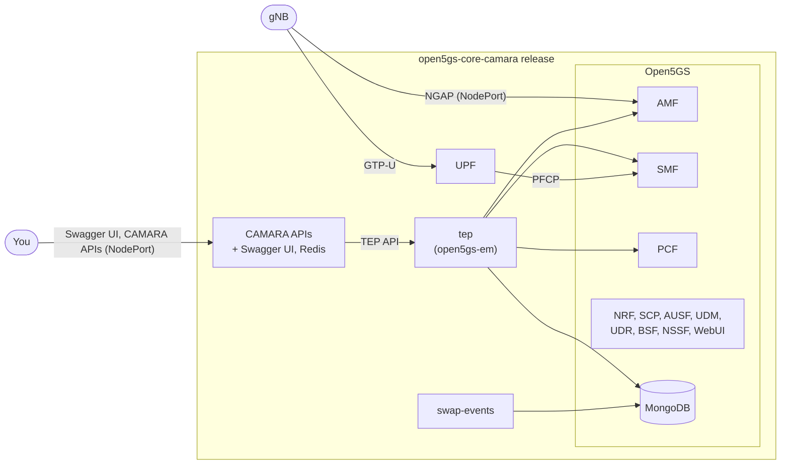

# Deploying the demo

[open5gs-core-camara](https://github.com/pnet-software/open5gs-core-camara) runs TEP end to end as one Helm release:
the Open5GS 5G core and its UPF, the TEP element manager for it, and the CAMARA APIs on top. Use it to try TEP on a
cluster of your own, or to show it. To add TEP to an Open5GS you already run, see
[Adding TEP to an existing Open5GS](deploy-existing-open5gs.md) instead.



There is no simulated radio: a gNB (real or simulated, such as UERANSIM) connects to the AMF, and UEs attach
through it.

## Before you start

| You need | Why |
|---|---|
| Kubernetes, with SCTP Services (on by default) | The AMF's NGAP is SCTP |
| Helm 3.8 or later | The charts are OCI artifacts on Docker Hub |
| A default StorageClass, or one you name | MongoDB's volume |
| Privileged pods allowed in the namespace | The UPF creates a TUN device (`NET_ADMIN`) |
| Free NodePorts | NGAP, the WebUI and Swagger UI. NodePorts are cluster-wide: two demos can't share one. |
| Access to Docker Hub | The charts and images (`pnetrepo`, `gradiant`, `bitnamilegacy`) |

One release per namespace: the element manager's Service is always called `tep`.

## 1. Choose your settings

The defaults install on any cluster, with PLMN 001/01, TAC 100 and SST 1. For anything else, write a values file.
A typical one:

```yaml
mongodb:
  persistence:
    storageClass: ""            # empty: the cluster's default

amf:
  services:
    ngap:
      nodePorts:
        ngap: "30412"           # fixed, so the gNB's configuration doesn't change
  config:
    guamiList:
      - plmn_id: { mcc: "001", mnc: "01" }
        amf_id: { region: 2, set: 1 }
    taiList:
      - plmn_id: { mcc: "001", mnc: "01" }
        tac: [100]
    plmnList:
      - plmn_id: { mcc: "001", mnc: "01" }
        s_nssai:
          - sst: 1
    networkName: demo

nrf:
  config:
    servingList:
      - plmn_id: { mcc: "001", mnc: "01" }

em:
  homePlmns: ["00101"]          # a UE served by any other PLMN is roaming

webui:
  services:
    http:
      nodePorts:
        http: "30999"

upf:
  config:
    upf:
      gtpu:
        advertise: "203.0.113.10"   # an address the gNB reaches on UDP 2152 (see step 4)

camara:
  swaggerUi:
    service:
      nodePort: "30080"
```

A PLMN goes in all four lists: `guamiList`, `taiList`, `plmnList` and `nrf.config.servingList`. Every setting is
described in the chart's [README](https://github.com/pnet-software/open5gs-core-camara/blob/main/charts/open5gs-core-camara/README.md),
and `helm show values oci://registry-1.docker.io/pnetrepo/open5gs-core-camara` lists them all.

## 2. Install

```bash
helm upgrade --install demo oci://registry-1.docker.io/pnetrepo/open5gs-core-camara --version 1.0.0 \
  -n demo --create-namespace -f my-values.yaml
```

The notes Helm prints give the NodePorts and addresses for this release. Wait for every pod to be ready:

```bash
kubectl -n demo get pods -w
kubectl -n demo logs deploy/demo-upf | grep -i pfcp      # "PFCP associated": the UPF found the SMF
```

## 3. Add subscribers

Open the WebUI at `http://<node IP>:<WebUI NodePort>` (user `admin`, password `1423`) and add a subscriber with its
IMSI, K and OPc. Give it an **MSISDN**: the CAMARA APIs find a device by its phone number, which TEP matches against
the subscriber's MSISDN.

Subscribers can also be created at install, with `populate.enabled: true` and `open5gs-dbctl` commands in
`populate.initCommands`.

## 4. Connect a gNB

Point the gNB at the AMF:

- **NGAP:** `<node IP>:<NGAP NodePort>`, over SCTP.
- **PLMN, TAC and slice:** as in your values (001/01, TAC 100, SST 1 by default).
- **GTP-U:** the gNB sends user traffic to the address the UPF advertises, `upf.config.upf.gtpu.advertise`. Its
  default, `<release>-upf-gtpu`, only resolves inside the cluster. For a gNB outside it, advertise an address it
  reaches on UDP 2152, and expose the UPF there, for example with `upf.services.gtpu.type: LoadBalancer`.

When a UE attaches and opens a PDU session, the WebUI shows it, and TEP reports it as connected.

## 5. Try the CAMARA APIs

Swagger UI is at `http://<node IP>:<Swagger UI NodePort>/`, with every API's spec. Tokens are off in the demo, so
requests can be sent straight from it, or with curl:

```bash
curl -s http://<node IP>:<Swagger UI NodePort>/device-reachability-status/v1/retrieve \
  -H 'Content-Type: application/json' -d '{"device": {"phoneNumber": "+306900000001"}}'
```

| To try | You need first |
|---|---|
| Reachability, roaming | A subscriber with an MSISDN; a UE attached for `CONNECTED` |
| SIM swap, device swap | Change a subscriber's IMSI or IMEISV; swap-events records it within its poll interval (30 s) |
| Location verification | The UE's cell registered in TEP (below) |
| QoS profiles | Nothing: the profiles come from `global.qualityProfiles` |
| Quality-On-Demand | A UE with a PDU session, and its IPv4 address in the session request |

**Cells.** Location verification compares the UE's current cell with an area, so TEP has to know where each cell
is. Register them through TEP, which is only reachable inside the cluster:

```bash
kubectl -n demo port-forward svc/tep 8080 &
curl -s http://localhost:8080/tep-api/v1/cell -H 'Content-Type: application/json' \
  -d '{"name": "cell-1", "plmn": {"mcc": "001", "mnc": "01"}, "nci": "000000010",
       "center": {"lat": 38.2466, "lon": 21.7346}, "radius": 500}'
```

The `nci` is the NR cell identity in nine hex digits, as the gNB is configured. TEP's own Swagger UI is at
`http://localhost:8080/` while the port-forward runs.

## Turning on tokens

With tokens, each API checks an OAuth2 access token, as its CAMARA spec declares. The chart can run Keycloak behind
the CAMARA Ingress: see "Turning on tokens" in the chart's
[README](https://github.com/pnet-software/open5gs-core-camara/blob/main/charts/open5gs-core-camara/README.md#turning-on-tokens).

## Removing it

```bash
helm uninstall demo -n demo
kubectl -n demo delete pvc -l app.kubernetes.io/instance=demo     # MongoDB's data, kept by uninstall
```
