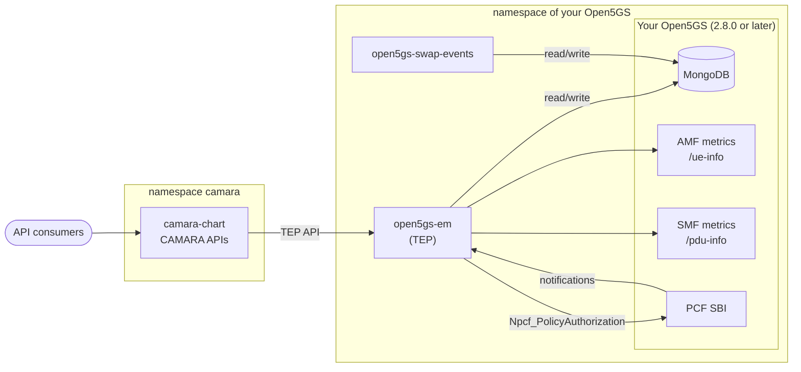

# Adding TEP to an existing Open5GS

This guide adds TEP and the CAMARA APIs to an Open5GS 5G core that already runs in a Kubernetes cluster, however it
was installed. Nothing in the core is replaced: three charts are installed next to it.

| Chart | What it adds |
|---|---|
| `oci://registry-1.docker.io/pnetrepo/open5gs-em-chart` | open5gs-em: the TEP API, served from the core's database and network functions |
| `oci://registry-1.docker.io/pnetrepo/open5gs-swap-events-chart` | open5gs-swap-events: records SIM and device swaps, which Open5GS doesn't keep |
| `oci://registry-1.docker.io/pnetrepo/camara-chart` | The CAMARA APIs, calling TEP |

To try everything on an empty cluster instead, see [Deploying the demo](deploy-demo.md).



## What your Open5GS must have

| Requirement | Why |
|---|---|
| **Open5GS 2.8.0 or later** (e.g. the `gradiant/open5gs:2.8.0` image) for the AMF, SMF and PCF | The version TEP is built and tested against |
| The **AMF and SMF metrics servers** on, reachable from TEP (port 9090) | TEP reads UE state from the AMF's `/ue-info` and PDU sessions from the SMF's `/pdu-info` |
| The **PCF's SBI** reachable from TEP (port 7777) | Quality-On-Demand sessions are PCF app sessions (Npcf_PolicyAuthorization) |
| The **PCF's `qos_profiles` and `reservation_priorities`** set, matching TEP's quality profiles | The PCF turns a profile name into a 5QI, and a priority band into an ARP level |
| **Read and write access** to the Open5GS database in MongoDB | TEP reads subscribers and adds PCC rules to their sessions; it and swap-events keep collections of their own there |
| The **PCF able to reach TEP** in the cluster | The PCF notifies TEP when the network ends a QoS session |

### Metrics on the AMF and SMF

In `amf.yaml` and `smf.yaml`, under the NF's own key:

```yaml
amf:                     # smf: in smf.yaml
  metrics:
    server:
      - dev: eth0        # or address: 0.0.0.0
        port: 9090
```

Then expose port 9090 with a Service each. With Gradiant's Open5GS charts, `amf.metrics.enabled: true` and
`smf.metrics.enabled: true` do both, as Services `<release>-amf-metrics` and `<release>-smf-metrics`.

### QoS profiles on the PCF

Each quality profile TEP offers is a name and a 5QI. The PCF needs the same mapping, in `pcf.yaml` under `pcf:`:

```yaml
pcf:
  qos_profiles:
    - reference: QOS_1         # a quality profile's name in TEP
      qos_index: 1             # its 5QI
    - reference: QOS_5
      qos_index: 5
  reservation_priorities:      # TEP bands a profile's priority (1-100) into PRIO_16 (highest) ... PRIO_1
    - res_prio: PRIO_16        # priority 1-7
      priority_level: 1        # ARP priority level
    - res_prio: PRIO_13        # priority 20-25
      priority_level: 4
```

Every profile in step 2 needs an entry here under its name. A name the PCF doesn't know makes session requests for
it fail. [QoS on Open5GS](open5gs.md#qos-on-open5gs) explains how TEP uses both lists.

## 1. Gather the addresses

The commands below use these placeholders. Replace them with your own:

| Placeholder | Example | |
|---|---|---|
| `<ns>` | `open5gs` | The namespace your Open5GS runs in |
| `<mongodb-uri>` | `mongodb://open5gs-mongodb:27017/open5gs` | The Open5GS database, with credentials if it has any |
| `<pcf>` | `open5gs-pcf-sbi:7777` | The PCF's SBI Service and port |
| `<amf-metrics>` | `open5gs-amf-metrics:9090` | The AMF's metrics Service and port |
| `<smf-metrics>` | `open5gs-smf-metrics:9090` | The SMF's metrics Service and port |

`kubectl -n <ns> get svc` lists them.

## 2. Install open5gs-em (TEP)

Install it in the core's namespace, so TEP and the PCF reach each other. Write `em-values.yaml`:

```yaml
mongodb:
  uri: <mongodb-uri>            # or existingSecret: a Secret with a MONGODB_URI key
config:
  pcfBaseUrl: http://<pcf>/npcf-policyauthorization/v1
  amfMetricsUrl: http://<amf-metrics>/ue-info
  smfMetricsUrl: http://<smf-metrics>/pdu-info
  pcfNotificationUrl: ""        # empty: TEP's own Service, which the PCF reaches in the cluster
# The subscribers' home PLMNs (MCC + MNC). A UE served by any other PLMN is roaming
homePlmns:
  - "00101"
# The quality profiles TEP offers. Each name and fiveQi must be in the PCF's qos_profiles
qualityProfiles:
  - name: QOS_1
    fiveQi: 1
    description: GBR flow with 5QI 1
    status: ACTIVE
    maxUpstreamRate: { value: 40, unit: Mbps }
    maxDownstreamRate: { value: 40, unit: Mbps }
    targetMinDownstreamRate: { value: 10, unit: Mbps }
    priority: 5
    preemptionCapability: NOT_PREEMPT
    preemptionVulnerability: PREEMPTABLE
  - name: QOS_5
    fiveQi: 5
    description: Non-GBR flow with 5QI 5
    status: ACTIVE
    maxUpstreamRate: { value: 40, unit: Mbps }
    maxDownstreamRate: { value: 40, unit: Mbps }
    priority: 22
    preemptionCapability: NOT_PREEMPT
    preemptionVulnerability: PREEMPTABLE
```

```bash
helm upgrade --install open5gs-em oci://registry-1.docker.io/pnetrepo/open5gs-em-chart --version 1.0.0 \
  -n <ns> -f em-values.yaml
```

TEP's address in the cluster is then `http://open5gs-em.<ns>:8080/tep-api/v1`. Check it answers:

```bash
kubectl -n <ns> port-forward svc/open5gs-em 8080 &
curl -s http://localhost:8080/tep-api/v1/quality-profile
```

TEP has no authentication and returns subscriber credentials. Keep it ClusterIP, and restrict who reaches it, for
example with a NetworkPolicy allowing only the CAMARA namespace and the PCF.

## 3. Install open5gs-swap-events

Without it, the SIM swap and device swap APIs have no history to answer from.

```bash
helm upgrade --install open5gs-swap-events oci://registry-1.docker.io/pnetrepo/open5gs-swap-events-chart \
  --version 1.0.0 -n <ns> --set mongodb.uri='<mongodb-uri>'
```

It runs as one pod, and records a change within one poll interval (`config.pollInterval`, 30 s).

## 4. Install the CAMARA APIs

Write `camara-values.yaml`, choosing the APIs to run:

```yaml
global:
  camara:
    tepBaseUrl: http://open5gs-em.<ns>:8080/tep-api/v1
    auth:
      enabled: false            # demo only; see below for tokens
reachability:
  enabled: true
roaming:
  enabled: true
locationverification:
  enabled: true
deviceswap:
  enabled: true
simswap:
  enabled: true
qosprofiles:
  enabled: true
qualityondemand:
  enabled: true
swaggerUi:
  service:
    type: NodePort              # or ingress.enabled and ingress.host
```

```bash
helm upgrade --install camara oci://registry-1.docker.io/pnetrepo/camara-chart --version 1.0.0 \
  -n camara --create-namespace -f camara-values.yaml
```

**Tokens.** For real use, turn `global.camara.auth.enabled` on, and either run Keycloak with the chart
(`global.camara.keycloak.deploy`, its `publicUrl`, `keycloak.admin.password`, and the Ingress) or point
`global.camara.auth.issuerUri` at your own authorization server. The camara chart's
[README](https://github.com/pnet-software/camara-tep/blob/main/charts/camara/README.md) covers every option, and the
install stops with a message naming any setting that's missing.

## 5. Check it end to end

1. A subscriber with an MSISDN, and a UE attached: the reachability API answers `CONNECTED` for its phone number.
2. `GET /quality-profile` on TEP lists your profiles, and the QoS Profiles API returns the same.
3. A Quality-On-Demand session for the UE's IPv4 address shows up as an app session in the PCF's log.
4. For location verification, register your cells in TEP (`POST /tep-api/v1/cell`), as in
   [Deploying the demo](deploy-demo.md#5-try-the-camara-apis).

## Upgrading

Each chart is released on its own (see [Deployment](deployment.md#images-charts-and-releases)). Upgrade one with the
same `helm upgrade --install` command and a newer `--version`. A change to the quality profiles needs the same change
in the PCF's `qos_profiles`, and restarts TEP.
