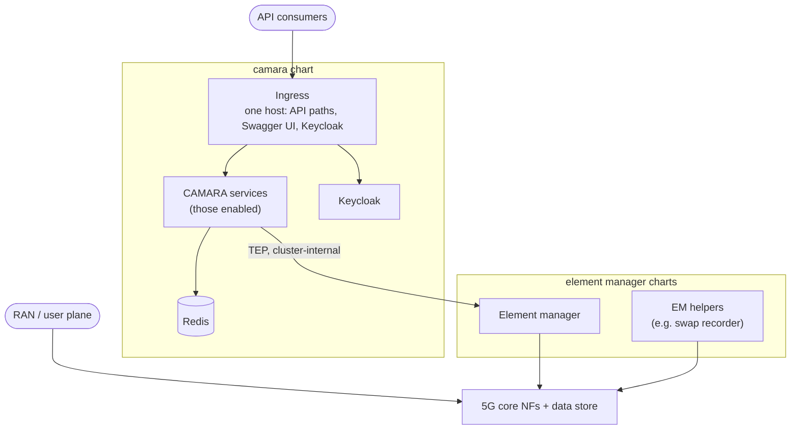

# Deployment

Everything runs on Kubernetes, installed with Helm charts from Docker Hub
(`oci://registry-1.docker.io/pnetrepo`). Next to a 5G core, a deployment adds two things: the
core's element manager (with any helpers it needs), and the CAMARA APIs.

## The releases

| Release | Chart | What it deploys |
|---|---|---|
| CAMARA APIs | `oci://registry-1.docker.io/pnetrepo/camara-chart` | Any set of the seven services, each from its own released chart. Also one Ingress host, one Swagger UI with every enabled API's spec, and Keycloak and Redis when needed, in the release or external. |
| Element manager | `oci://registry-1.docker.io/pnetrepo/<core>-em-chart` | TEP for that core, pointed at the core's data store and network functions |
| EM helpers | One chart each, e.g. `<core>-swap-events-chart` | What the EM needs that the core lacks |

The camara chart reaches TEP through `global.camara.tepBaseUrl`. That URL is the only link
between the CAMARA APIs and the core side, and the only thing that changes when the core changes.

The quality profiles the EM serves must match the QoS configuration of the core's policy
control, so a profile name always maps to the 5QI it promises.

Every chart installs on any cluster with its defaults. A deployment sets its own addresses,
PLMNs, storage class, NodePorts and Ingress host in its values files.

## Ways to deploy

| | For | Guide |
|---|---|---|
| The demo | Trying TEP end to end on an empty cluster: one release with Open5GS, its UPF, the EM, its helpers and the CAMARA APIs | [Deploying the demo](deploy-demo.md) |
| Next to an existing core | An Open5GS you already run: the EM, its helpers and the CAMARA APIs, each from its own chart | [Adding TEP to an existing Open5GS](deploy-existing-open5gs.md) |

Each core's specifics are on its page, e.g. [Open5GS implementation](open5gs.md#deployment).

## Images, charts and releases

Every component is versioned and released on its own, from a tag. GitHub Actions builds and
publishes it to Docker Hub (`pnetrepo`), and creates a GitHub Release with its notes:

| Repository | Tag | Publishes |
|---|---|---|
| camara-tep | `<service>-vX.Y.Z` | Image `pnetrepo/<service>` and chart `pnetrepo/<service>-chart` |
| camara-tep | `camara-vX.Y.Z` | Chart `pnetrepo/camara-chart`, which pins one released version of each service chart |
| An element manager or helper | `vX.Y.Z` | Image `pnetrepo/<component>` and chart `pnetrepo/<component>-chart` |
| A demo chart | `vX.Y.Z` | Chart `pnetrepo/<core>-core-camara`, which pins one version of each chart it combines |

Upgrading a component in a deployment therefore takes one or two steps. Release the component,
then either upgrade its own release, or bump its pinned version in the umbrella chart (camara or
the demo) and release that.

## Trust boundaries

| Boundary | Protection |
|---|---|
| API consumers → CAMARA services | OAuth2 access tokens with the API's scope. Only the Ingress is exposed: API paths, spec files, Swagger UI and Keycloak. |
| Actuator (health, metrics) | Its own management port, which the Ingress never exposes |
| CAMARA services → TEP | **None.** TEP is cluster-internal and unauthenticated. It returns subscriber credentials, so it must never be exposed. |
| TEP → CAMARA QoD notifications | **None.** `/tep-notifications` is outside the Ingress's paths. |
| Element manager → core | Cluster-internal. The core's data store, SBI and metrics endpoints stay ClusterIP. |
| Outside → core | Only what the RAN needs (NGAP for gNBs) and any operator UI the core ships. Each core's page lists its exposed ports. |

Phone numbers never appear in URLs on any hop, and the services mask them in logs.
