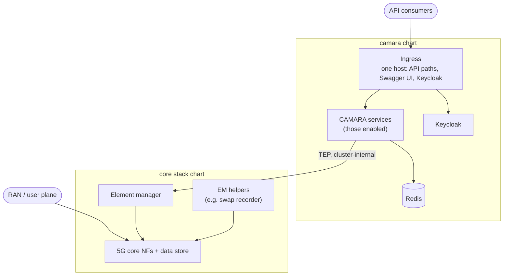

# Deployment

Everything runs on Kubernetes, installed with Helm charts from Docker Hub
(`oci://registry-1.docker.io/pnetrepo`). A full deployment is two Helm releases: the CAMARA
APIs and a core with its element manager.

## The two releases

| Release | Chart | What it deploys |
|---|---|---|
| CAMARA APIs | `oci://registry-1.docker.io/pnetrepo/camara-chart` | Any set of the seven services, each from its own released chart. Also one Ingress host, one Swagger UI with every enabled API's spec, and Keycloak and Redis when needed, in the release or external. |
| Core + EM | One stack chart per implemented core | The core's network functions, its element manager, and any helpers the EM needs, wired by release name |

The camara chart reaches TEP through `global.camara.tepBaseUrl`. That URL is the only link
between the two releases, and the only thing that changes when the core changes.

The core stack keeps the quality profiles the EM serves in step with the QoS configuration
of the core's policy control, so a profile name always maps to the 5QI it promises.

Both charts install on any cluster with their defaults. A deployment sets its own PLMNs,
storage class, NodePorts and Ingress host in its values file.

Each core's stack chart and its specifics are on the core's page:

| Core | Stack chart | Details |
|---|---|---|
| Open5GS | `oci://registry-1.docker.io/pnetrepo/open5gs-em-stack` | [Open5GS implementation](open5gs.md#deployment) |

## Images, charts and releases

Every component is versioned and released on its own, from a tag. GitHub Actions builds and
publishes it to Docker Hub (`pnetrepo`), and creates a GitHub Release with its notes:

| Repository | Tag | Publishes |
|---|---|---|
| camara-tep | `<service>-vX.Y.Z` | Image `pnetrepo/<service>` and chart `pnetrepo/<service>-chart` |
| camara-tep | `camara-vX.Y.Z` | Chart `pnetrepo/camara-chart`, which pins one released version of each service chart |
| An element manager or helper | `vX.Y.Z` | Image `pnetrepo/<component>` and chart `pnetrepo/<component>-chart` |
| A core stack | `vX.Y.Z` | Chart `pnetrepo/<core>-em-stack`, which pins one version of each EM and helper chart |

Upgrading a component in a deployment therefore takes two steps. Release the component,
then bump its pinned version in the umbrella chart (camara or stack) and release that.

## Trust boundaries

| Boundary | Protection |
|---|---|
| API consumers → CAMARA services | OAuth2 access tokens with the API's scope. Only the Ingress is exposed: API paths, spec files, Swagger UI and Keycloak. |
| Actuator (health, metrics) | Its own management port, which the Ingress never exposes |
| CAMARA services → TEP | **None.** TEP is cluster-internal and unauthenticated. It returns subscriber credentials, so it must never be exposed. |
| TEP → CAMARA QoD notifications | **None.** `/tep-notifications` is outside the Ingress's paths. |
| Element manager → core | Cluster-internal. The core's data store, SBI and metrics endpoints stay ClusterIP. |
| Outside → core | Only what the RAN needs (NGAP for gNBs) and any operator UI the core ships. Each core's page lists its exposed ports. |

Phone numbers never appear in URLs on any hop, and the services mask them in logs.
