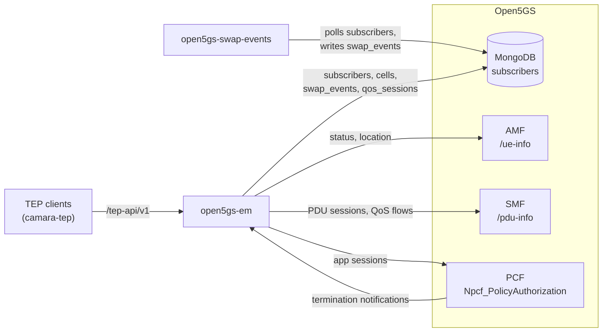

# Element managers

An element manager (EM) serves the TEP API for one 5G core. It answers every TEP operation
from that core's own data and network functions. Everything core-specific lives in the EM,
and nothing core-specific lives anywhere else.

## What a core must provide

| TEP needs | Why |
|---|---|
| Read and write subscribers (IMSI, MSISDN, K, OPc, AMF, slices and DNNs) | Subscriber provisioning |
| The UE's registration and connection state, serving PLMN, and PDU sessions with their addresses and QoS flows | `POST /subscriber/status`, and so reachability, roaming and QoD |
| The UE's current cell (NCGI) and when it was reported | `POST /subscriber/location` |
| A record of IMSI and IMEISV changes per MSISDN | `POST /subscriber/swaps` |
| Policy control that applies a QoS level to an application flow, keyed by a QoS reference that maps to a 5QI | AS sessions with QoS |
| Notifications when the network ends such a flow | QoD's `NETWORK_TERMINATED` |

A core that lacks one of these can still serve TEP. The operations that depend on it answer
an error, and the CAMARA APIs built on them aren't available on that core.

## Open5GS: the reference implementation

Three components, each in its own repository:

- **[open5gs-em](https://github.com/pnet-software/open5gs-em)** is one Spring
  Boot app. Its server interfaces are generated from the TEP spec. Its only northbound
  entrypoint is `/tep-api/v1`.
- **[open5gs-swap-events](https://github.com/pnet-software/open5gs-swap-events)**
  is the swap recorder Open5GS lacks. Every poll interval it compares each subscriber with its
  `swap_events` row, and records when the IMSI or IMEISV of an MSISDN last changed. Its
  timestamps are when a poll saw the change: late by at most one interval, never early.
- **[open5gs-em-stack](https://github.com/pnet-software/open5gs-em-stack)** deploys the Open5GS
  core, open5gs-em and open5gs-swap-events as one Helm release, wired to each other.

### Where each answer comes from

| TEP operation | Open5GS source |
|---|---|
| Subscribers | `subscribers`, the collection the Open5GS WebUI writes, written in the same shape. The subscriber id is the document's `_id`. |
| Status | AMF `ue-info` (connection state, serving PLMN) and SMF `pdu-info` (PDU sessions, QoS flows), matched by SUPI. `roaming` compares the serving PLMN with the configured home PLMNs. |
| Location | The NR cell and timestamp in AMF `ue-info`, plus the coverage area from TEP's own `cells` collection |
| Swaps | `swap_events`, written by open5gs-swap-events |
| Quality profiles | The EM's configuration |
| Cells | TEP's own `cells` collection |
| AS sessions with QoS | PCF app sessions (Npcf_PolicyAuthorization), tracked in `qos_sessions` |

### QoS on Open5GS

open5gs-em acts as a 3GPP NEF for the AsSessionWithQoS API:

1. **qosReference to 5QI.** The session's `qosReference`, a quality profile name, is passed to
   the PCF, which maps it to a 5QI through its `qos_profiles` configuration. The stack
   renders that configuration from the same list of quality profiles the EM serves, so the
   two can't disagree.
2. **PCC rule.** The PCF only authorizes a 5QI for which the UE's PDU session has a PCC
   rule. Before asking the PCF, the EM gives the session one if it has none. Open5GS limits
   a session to 8 PCC rules and 4 QoS flows (so at most 3 QoS sessions per UE), and the EM
   enforces both.
3. **Rates and ARP** come from the quality profile's fields and are sent in the media
   component.
4. **Termination.** When the PCF ends an app session, it notifies the EM. The EM notifies
   the application server at `{notificationDestination}/notifications`.

## Adding another core

1. **Create the EM** in its own repository, e.g. `<core>-em`. Copy the two spec files from
   [tep-openapi](https://github.com/pnet-software/tep-openapi) and generate the server
   from them.
2. **Map each operation** to the core's data and network functions, using the table above as
   the reference. Operations the core can't support answer an error (unimplemented ones
   answer 501).
3. **Keep the conventions:** opaque subscriber ids, phone numbers only in bodies, the
   `x-correlator` echo, and RFC 9457 errors.
4. **Provide what the deployment needs:** quality profiles mapped to 5QIs in the core's
   policy control, and a swap recorder if the core keeps no history of IMSI and IMEI changes.
5. **Point the CAMARA services at it** through `TEP_BASE_URL` (the camara chart's
   `global.camara.tepBaseUrl`). Nothing in camara-tep changes.
