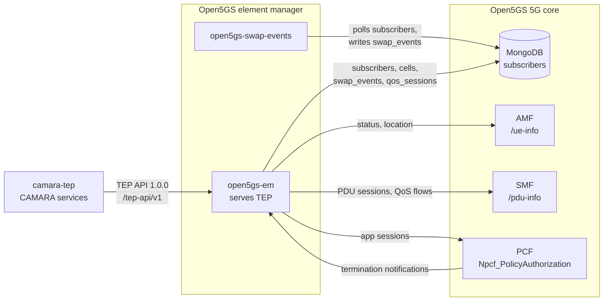
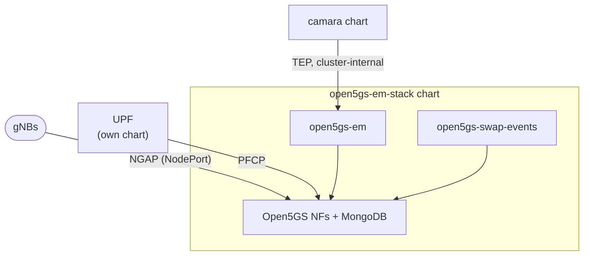

# Open5GS implementation

[Open5GS](https://open5gs.org/) is the first core with a TEP element manager. All seven CAMARA
APIs run on it. This page covers what's specific to that core. What any core must provide is
in [Element managers](element-managers.md).

## The picture

## Repositories

| Repository | What it holds |
|---|---|
| [open5gs-em](https://github.com/pnet-software/open5gs-em) | The TEP API on Open5GS |
| [open5gs-swap-events](https://github.com/pnet-software/open5gs-swap-events) | Records SIM and device swaps from Open5GS's subscribers |
| [open5gs-em-stack](https://github.com/pnet-software/open5gs-em-stack) | One chart for the Open5GS core, open5gs-em and open5gs-swap-events |

- **open5gs-em** is one Spring Boot app. Its server interfaces are generated from the TEP
  spec, whose copy it keeps in `src/main/resources/static/openapi/`. Its only northbound
  entrypoint is `/tep-api/v1`.
- **open5gs-swap-events** is the swap recorder Open5GS lacks. Every poll interval it compares
  each subscriber with its `swap_events` row, and records when the IMSI or IMEISV of an MSISDN
  last changed. Its timestamps are when a poll saw the change: late by at most one interval,
  never early. Polling works with any MongoDB deployment, a standalone one included. A change
  stream would give exact times, but it needs a replica set.
- **open5gs-em-stack** deploys the Open5GS core, open5gs-em and open5gs-swap-events as one
  Helm release, wired to each other.

## Where each answer comes from

| TEP operation | Open5GS source |
|---|---|
| Subscribers | `subscribers`, the collection the Open5GS WebUI writes, written in the same shape. The subscriber id is the document's `_id`. |
| Status | AMF `ue-info` (connection state, serving PLMN) and SMF `pdu-info` (PDU sessions, QoS flows), matched by SUPI. `roaming` compares the serving PLMN with the configured home PLMNs. |
| Location | The NR cell and timestamp in AMF `ue-info`, plus the coverage area from TEP's own `cells` collection |
| Swaps | `swap_events`, written by open5gs-swap-events |
| Quality profiles | The EM's configuration |
| Cells | TEP's own `cells` collection |
| AS sessions with QoS | PCF app sessions (Npcf_PolicyAuthorization), tracked in `qos_sessions` |

## QoS on Open5GS

open5gs-em acts as a 3GPP NEF for the AsSessionWithQoS API:

1. **qosReference to 5QI.** The session's `qosReference`, a quality profile name, is passed to
   the PCF, which maps it to a 5QI through its `qos_profiles` configuration. The stack
   renders that configuration from the same list of quality profiles the EM serves, so the
   two can't disagree.
2. **PCC rule.** The PCF only authorizes a 5QI for which the UE's PDU session has a PCC
   rule. Before asking the PCF, the EM gives the session one if it has none. Open5GS limits
   a session to 8 PCC rules and 4 QoS flows (so at most 3 QoS sessions per UE), and the EM
   enforces both.
3. **Rates and ARP** come from the quality profile's fields and are sent in the media
   component.
4. **Termination.** When the PCF ends an app session, it notifies the EM. The EM notifies
   the application server at `{notificationDestination}/notifications`.

## Deployment

The core-and-EM release is `oci://registry-1.docker.io/pnetrepo/open5gs-em-stack`. It deploys
Open5GS (AMF, AUSF, BSF, NRF, NSSF, PCF, SCP, SMF, UDM, UDR, WebUI, MongoDB), open5gs-em and
open5gs-swap-events, wired by release name. The UPF has its own chart.

The stack keeps one list of quality profiles (`global.qualityProfiles`). open5gs-em serves
it, and the PCF's `qos_profiles` is rendered from it.

Inside the cluster, MongoDB, the PCF SBI and the AMF/SMF metrics are ClusterIP. Only the AMF's
NGAP (for gNBs) and the WebUI are NodePorts.

### Releases

| Repository | Tag | Publishes |
|---|---|---|
| open5gs-em | `vX.Y.Z` | Image `pnetrepo/open5gs-em` and chart `pnetrepo/open5gs-em-chart` |
| open5gs-swap-events | `vX.Y.Z` | Image `pnetrepo/open5gs-swap-events` and chart `pnetrepo/open5gs-swap-events-chart` |
| open5gs-em-stack | `vX.Y.Z` | Chart `pnetrepo/open5gs-em-stack`, which pins one version each of the em and swap-events charts |

Charts, releases and trust boundaries for the whole system are in [Deployment](deployment.md).
